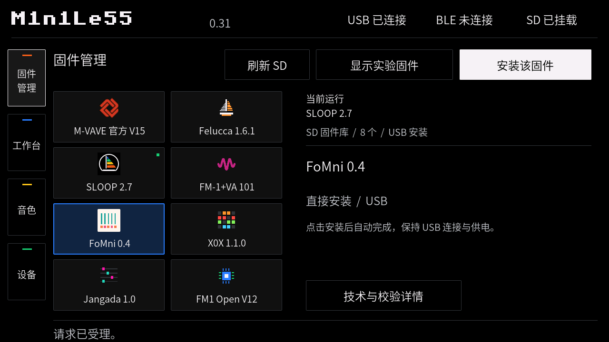

# 0.31 / firmware-grid-1

[简体中文](RELEASE_0.31_GRID.md) · [English](RELEASE_0.31_GRID.en.md)

Firmware management update, 2026-10-22.

- Two compact columns of cards show icons above names. Eight regular firmware entries fit on screen; experimental entries add row-snapped scrolling.
- Top controls are Refresh SD → Show/hide experimental firmware → Install selected firmware. Selecting the currently installed identity shows Reinstall.
- Tapping a card only changes selection. Details, installation conditions and the automatic V15 bridge remain in place.
- M-VAVE, SLOOP and Baud Girl use publisher marks; the remaining pixel icons were drawn for this project. See [artwork notices](../licenses/firmware-icons/NOTICES.md).
- Unmatched files use a neutral icon. Long names are abbreviated on cards and shown in the details panel.

Release checks passed: ESP-IDF 5.4.2 build; UI regression with 266 route transitions and 256 screens, including card selection without installation, scrolling, button order and selected installation targets; 13 installation-tool and 18 SD-tool tests; font coverage with no newly missing glyphs. These are pre-release development checks; their scripts are not part of this minimal public repository.

Application image: 2,477,024 bytes. SHA-256: `60f96ef8782f862f3e3b865ba27914de195497fee2e519c614effdf2e22af20b`.

Download `M1n1Le55-0.31-grid-1.zip` from [Releases](https://github.com/ZzpsS/M1n1Le55/releases/tag/v0.31-grid-1). The firmware version remains 0.31. The minimal bilingual distribution changes packaging and documentation; its three flash images, UI and firmware behavior remain those of firmware-grid-1.

## Hardware upgrade record — 2026-10-22

- Tested on one original Tab5 already running `0.31 / recovery-1`, with P4 v1.3, not a factory-new unit.
- `app-update` detected a different old bootloader and stopped before writing. After a separate readback confirmed an identical partition table, `first-install` updated the bootloader, partition table and application, with flash digest verification passing. NVS, C6 and FM-1 firmware were not written.
- After restart, diagnostics reported `M1n1Le55 / 0.31 / firmware-grid-1`, 1280 × 720. Main-page transitions and return to firmware management passed; SD mounted with ten packages detected.
- FM-1 remained connected over USB as `FM-1_916`. This check requested no FM-1 firmware installation or musical-parameter writes; bad-frame and parameter-write counters stayed at zero.

`Device bootloader/partitions differ` means application-update mode did not write anything. For an older M1n1Le55 with the same partition layout, use the complete first-install command in [Getting started](GETTING_STARTED_0.31.en.md#2-install-on-tab5). If the layout is unknown or belongs to another system, preserve needed data through that system's backup method before replacing it.

This record covers flashing, startup and diagnostic page switching, not physical touch operation, audio performance or all FM-1 migration routes. The screenshot is from the offline simulator; raw device logs are not distributed.

## Compatibility scope

| Item | Scope |
| --- | --- |
| Board | Original Tab5, P4 16 MB Flash / 32 MB PSRAM; not a generic P4 board |
| Chip revisions | P4 v0.1–v1.99; application eFuse block revision ≤0.99 |
| Display | ILI9881C/GT911, ST7123 and ST7121/ST712x code; hardware records only for ST7121 / P4 v1.3 |
| C6 | Not flashed by this bundle; BLE needs compatible ESP-Hosted firmware; historical records used C6 1.4.1 |
| FM-1 installation | Exact catalog packages only; renaming does not allow unknown versions |
| SD | FAT32; restart after mount failure; no automatic formatting or hot-plug recovery; preparation tool supports Windows drive roots |
| Stock backup | Current 155-byte voice only; no whole-device backup or touchscreen JSON restore |
| Samples | Open app protocol 4/FM1S; hardware evidence from experimental V913, not all firmware |

Factory-new installation, automatic V15 migration, other display batches, C6 variants and power-loss recovery still require hardware acceptance. This release remains marked **Pre-release**.
